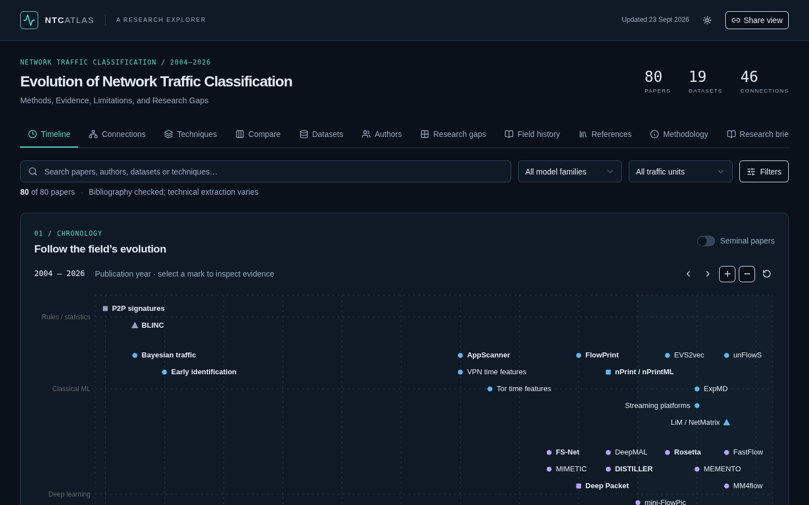

# NTC Atlas

**An interactive, evidence-backed atlas of network traffic classification research.**

Live site: **https://ntc-atlas.pages.dev**

NTC Atlas follows the evolution of network traffic classification from port rules and flow statistics to deep learning, pretrained models and traffic foundation models. Encrypted traffic is a central theme. Every analytical statement links to its source, and paper claims, later criticism and curator interpretation stay separate. The atlas is curated and maintained by Mohamed Hashim Changrampadi.



<!-- corpus-counts:start (generated by `pnpm counts`; checked by `pnpm validate`) -->
| Papers | Authors | Datasets | Relationships | Evidence records |
| ---: | ---: | ---: | ---: | ---: |
| 81 | 274 | 19 | 70 | 413 |
<!-- corpus-counts:end -->

## Who it is for

- PhD students entering traffic classification and looking for a reading path.
- Researchers checking which results are comparable, which datasets are overused and where leakage may exist.
- Reviewers and practitioners asking what is reported about throughput, latency, memory and deployability.

## Features

- **Timeline** of methodological generations with collision-aware labels.
- **Connections graph** of documented extensions, critiques and baseline comparisons. Each relationship type is drawn differently, and a baseline comparison is never shown as a successor.
- **Techniques** view of how inputs and model families changed.
- **Compare** up to five papers side by side. Each value keeps its unit and scope, and missing values carry a qualified NA.
- **Datasets** with label provenance, assignment units and version caveats.
- **Authors and institutions** built from verified publication bylines, with confirmed Google Scholar profiles where known.
- **Research-gap matrix** across 16 dimensions, each cell linked to evidence.
- **Research briefings** (coming soon): curator analysis of where the field is heading, published as a newsletter.
- **Field history** and a full **methodology** page.
- Search, filters, sorting and pagination. Every view has a shareable URL, e.g. `?view=authors&person=luming-yang`.
- Light and dark themes.
- **Exports** of any selection as CSV, JSON or BibTeX, plus the raw JSON corpus.

## Data and evidence methodology

The corpus lives in versioned JSON files in `public/data/`:

| File | Content |
| --- | --- |
| `papers.json` | Bibliography, methods, evaluation fields, gap states and review depth |
| `authors.json` | Names, aliases, dated affiliations, papers and profile links |
| `datasets.json` | Provenance, traffic units, labels, caveats and recorded uses |
| `relationships.json` | Directed paper-to-paper relationships with supporting evidence IDs |
| `evidence.json` | Source URL and type, paraphrase, locator, verification status and access date |
| `label-provenance.json` | Label evidence, assignment unit and semantic object per dataset |
| `history.json` | Evidence-linked narrative periods |
| `meta.json` | Scope, counts, author-inclusion rule and evidence boundaries |

Curation rules:

- **Primary sources first.** Titles, author order, year and venue are checked against the original paper, DOI record, publisher, proceedings or authoritative repository. Preprints and peer-reviewed versions are tracked separately.
- **Authors enter only through verified bylines.** Seed lists and Google Scholar are used for discovery and identity. A publication byline and a dated affiliation are verified separately. Committee membership is never evidence of a relevant publication.
- **Relationships need evidence.** An extension, critique or comparison is recorded only when a source states it. Chronology alone never creates an edge.
- **Qualified NA.** Comparison fields say `NA: not reported in reviewed sections`, `NA: not applicable` or `NA: not yet extracted`.
- **Scoped results.** Accuracy and F1 appear with their dataset, split, task and metric. Offline samples per second are never presented as live network throughput.
- **No reproduction claims.** Linked artefacts have not been rerun.

The Methodology view on the site explains these rules in full.

## Data limitations

This is a curated, evolving corpus, not a systematic review. Technical extraction depth varies by paper, and each record states its review depth. A gap cell marked "Not addressed/not reported" means the reviewed evidence did not establish coverage. Absence from this corpus is not evidence of absence from the field. Open extraction work is listed in [docs/RESEARCH-BACKLOG.md](docs/RESEARCH-BACKLOG.md).

## Run locally

Requires Node.js 22 (see `.node-version`) and Corepack, which ships with Node.

```bash
git clone https://github.com/cmhashim/ntc-atlas.git
cd ntc-atlas
corepack enable
pnpm install --frozen-lockfile
pnpm dev            # http://localhost:5173
```

The project pins pnpm through the `packageManager` field in `package.json`.

## Validate and build

```bash
pnpm validate       # corpus integrity checks (scripts/validate-data.mjs)
pnpm typecheck      # TypeScript
pnpm lint           # ESLint
pnpm build          # static export into out/
pnpm check          # all four, as CI runs them
pnpm preview        # serve out/ locally through Wrangler (http://localhost:8788)
```

The build is a fully static site. All views run in the browser over the bundled JSON, so hosting needs no server, database or API key. To host under a sub-path, e.g. GitHub Pages, build with `NEXT_PUBLIC_BASE_PATH=/ntc-atlas pnpm build`.

## Deployment

`.github/workflows/deploy.yml` runs the four checks on every push and pull request.

- Pushes to `main` deploy to Cloudflare Pages at https://ntc-atlas.pages.dev.
- Pull requests from this repository get a preview URL in the workflow summary.
- A manual deploy is available under **Actions → Check and deploy → Run workflow**.

The workflow needs two repository secrets: `CLOUDFLARE_API_TOKEN` (scoped to *Account → Cloudflare Pages → Edit*) and `CLOUDFLARE_ACCOUNT_ID`.

## Updating the corpus

1. Verify the primary source before adding a paper to `scripts/curate.py`. Put unresolved candidates in the pending queue.
2. Resolve duplicates, versions and author aliases. Keep distinct follow-up models separate.
3. Record analytical evidence with URL, source type, paraphrase, locator, verification status and access date.
4. Add only relationships supported by their own evidence.
5. Scope every gap judgement to reviewed evidence and explain it in the cell note.
6. Regenerate, then run the checks:

```bash
python3 scripts/curate.py
pnpm counts         # refresh the counts table above
pnpm check
```

Keep `history.json` curated by hand. Change the research date in `meta.json` only after a renewed source review.

## Citing

If you use the atlas or its data, please cite it. GitHub's **Cite this repository** button (from [CITATION.cff](CITATION.cff)) gives APA and BibTeX formats.

> Changrampadi, M. H. *NTC Atlas: an interactive, evidence-backed atlas of network traffic classification research.* https://github.com/cmhashim/ntc-atlas

Cite the original papers for any result you take from the atlas.

## Contributing

Suggestions for papers, metadata corrections and author identity fixes are welcome. Please use the issue forms and read [CONTRIBUTING.md](CONTRIBUTING.md) first. Every change needs a primary source.

## Licence

- **Code:** MIT, see [LICENSE](LICENSE).
- **Curated data** in `public/data/`: CC BY 4.0, see [LICENSE-DATA](LICENSE-DATA).
- Vendored third-party files keep their own licences (`vendor/`).
- The cited papers, datasets and web pages belong to their authors and publishers. The atlas stores citations and short paraphrases only, not PDFs or traffic captures.

Planned work is in [docs/ROADMAP.md](docs/ROADMAP.md). Earlier changes are in [CHANGELOG.md](CHANGELOG.md). Browser QA notes from earlier releases are in [docs/QA-HISTORY.md](docs/QA-HISTORY.md).
